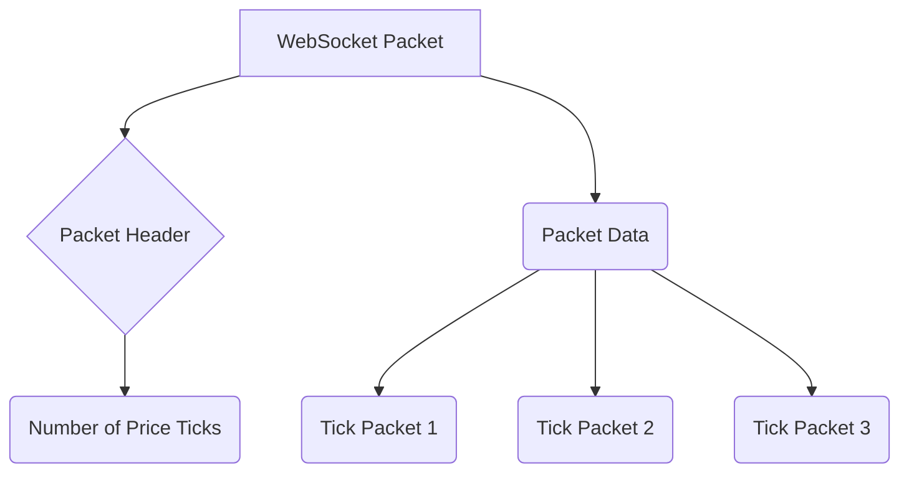

<!-- Source: https://vortex.rupeezy.in/docs/2.2/feed/ -->

# Live Data

Implementing an asynchronous WebSocket client with a binary parser for the market data structure may be a complex task. We recommend using one of our pre-built [client libraries](24-sdks.md#sdks).

## Websocket endpoint

```
wss://wire.rupeezy.in/ws?auth_token={{access_token}}
```

## Limits

- With one access_token, you can connect at most 3 concurrent websockets
- In one websocket, you can simbultaneously be subscribed to at most 1000 instruments

## Subscribing & Unsubscribing to instruments

To subscribe to any instrument, you need to send a json message in the below format. Make sure that you send messages in text mode, and not binary.

### Subscription payload

```
{
    "ticker": "NSE:NIFTY",
    "mode": "ltp",
    "message_type": "subscribe"
}
```

### Unsubscription payload

```
{
    "ticker": "NSE:NIFTY",
    "mode": "ltp",
    "message_type": "unsubscribe"
}
```

| field | required | description |
| --- | --- | --- |
| ticker | Y* | Instrument ticker in `EXCHANGE:SYMBOL` form (e.g. `NSE:NIFTY`). Recommended. Pass **either** `ticker` **or** (`exchange` + `token`). |
| exchange | Y* | Possible values: [NSE_EQ, NSE_FO, NSE_CUR or MCX_FO]. Required if `ticker` is not provided. |
| token | Y* | Security token of the scrip, found in the scripmaster file. Required if `ticker` is not provided. |
| mode | Y | Mode of subscription. Possible values: [ltp,ohlcv,full] |
| message_type | Y | Possible values: [subscribe,unsubscribe] |

## Decoding packets

Websocket can send data in either binary mode, or in text mode. You need to check the mode of the packet before decoding. Price feed always comes in binary mode, while updates come in text mode.

### Message structure



- Each websocket message is encoded using [little endian](https://en.wikipedia.org/wiki/Endianness) encoding. The same should be used to decode the packet.
- Each message can have multiple price quotes
- Each price quote is preceded by two bytes which when converted to `int16`, indicate the number of bytes that should be considered for the price quote. We can call it the quote length.
- The quote length can have 3 values, depending on the mode in which the instrument is subscribed. It is 22 for `ltp` ,62 for `ohlcv` and 266 for `full`.
- Depending on the length received, you should use the below structure to decode falues

> [!NOTE]
>
> The binary tick format carries only `Exchange` + `Token` because each packet is a fixed-size struct. Our official SDKs (e.g. `vortex_api` for Python) automatically resolve the `ticker` field client-side from the instrument master so your tick callback receives `{ticker, exchange, token, ...}`. If you are writing your own client, look up the ticker using the [scripmaster](16-instrument-list.md) file.

#### Packet Structure

| Field Name | Data Type | Size (bytes) | Description |
| --- | --- | --- | --- |
| Exchange | string | 10 | The exchange name |
| Token | int32 | 4 | Token representing the stock |
| LastTradePrice | float64 | 8 | Last trade price |
| LastTradeTime | int32 | 4 | Time of the last trade (optional) |
| OpenPrice | float64 | 8 | Opening price (optional) |
| HighPrice | float64 | 8 | Highest price today (optional) |
| LowPrice | float64 | 8 | Lowest price today (optional) |
| ClosePrice | float64 | 8 | Closing price of the previous day (optional) |
| Volume | int32 | 4 | Total volume traded (optional) |
| LastUpdateTime | int32 | 4 | Time of the last update (optional) |
| LastTradeQuantity | int32 | 4 | Quantity of the last trade (optional) |
| AverageTradePrice | float64 | 8 | Average trade price (optional) |
| TotalBuyQuantity | int64 | 8 | Total quantity bought (optional) |
| TotalSellQuantity | int64 | 8 | Total quantity sold (optional) |
| OpenInterest | int32 | 4 | Open interest (optional) |
| Depth.Buy | - | - | Buy depth (nested structure, see table below) |
| Depth.Sell | - | - | Sell depth (nested structure, see table below) |
| DPRHigh | int32 | 4 | High value for daily price range (optional) |
| DPRLow | int32 | 4 | Low value for daily price range (optional) |

##### Nested Buy depth structure

| Field Name | Data Type | Size (bytes) | Description |
| --- | --- | --- | --- |
| Price | float64 | 8 | Price of the buy order |
| Quantity | int32 | 4 | Quantity of the buy order |
| Orders | int32 | 4 | Number of buy orders |

##### Nested Sell depth structure

| Field Name | Data Type | Size (bytes) | Description |
| --- | --- | --- | --- |
| Price | float64 | 8 | Price of the sell order |
| Quantity | int32 | 4 | Quantity of the sell order |
| Orders | int32 | 4 | Number of sell orders |

## Order Messages

The websocket delivers postbacks and other updates in the text mode. These messages are in JSON format. For order postbacks, the message structure is the same as defined in [postbacks section](19-postbacks.md#postbacks)
